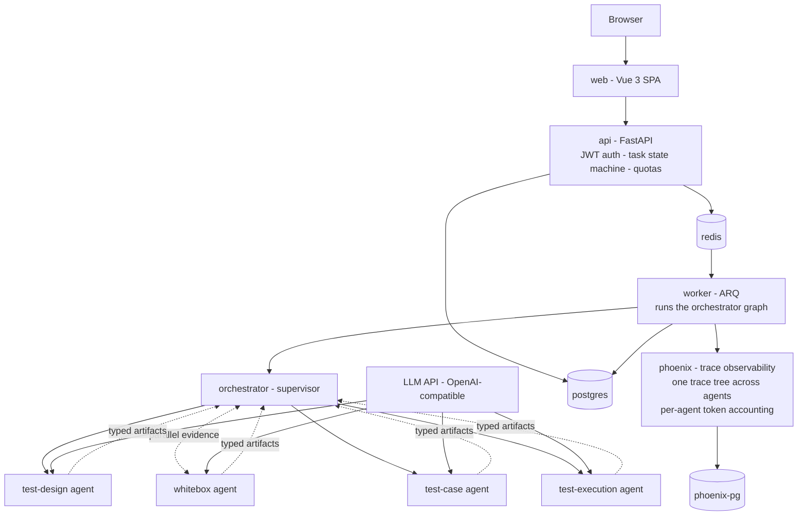

# mini-agent-test

A self-hostable, fully dockerized **multi-agent collaboration platform** —
domain agents (test design, whitebox analysis, test cases, execution) working
under a supervisor orchestrator, with the production elements that separate a
demo from a system people rely on: async task queues, multi-tenant isolation,
auth, cost quotas, retries, and centralized observability.

**Why this exists:** the problem comes from a real AI testing platform I own —
an internal system whose agent acts as a Project Test Manager, in daily use by
80+ engineers across 8 business lines. Running it taught me where local
tooling stops and production begins. Industry practice (at every major tech
company) is the same shape: **not one clever agent, but several narrow agents
collaborating over structured artifacts, with humans at the gates.** This repo
is my independent, from-scratch implementation of that pattern.

## What it does (v0 scope)

One flow, four domain agents, two human gates:

```
PRD -> [test-design agent] <-- parallel evidence -- [whitebox agent]
          |                                             (interfaces, edges)
          v
      HUMAN GATE (is the strategy right?)
          v
      [test-case agent]  -> draft cases (steps, data, assertions)
          v
      HUMAN GATE (can these run?)
          v
      [test-execution agent] -> run, collect -> execution report
```

Every agent is itself a small LangGraph; a supervisor orchestrator routes
tasks across agents, and agents exchange **typed artifacts** (pydantic), never
free-form chat.

## Architecture



Seven containers, one `docker compose up`.

## Quickstart

```bash
cp .env.example .env        # fill in OPENAI_API_KEY and a random JWT_SECRET
docker compose up --build   # postgres + redis + phoenix + api + worker + web

# sign in (seeded users; alice/bob share tenant "acme" with a small budget)
curl -s localhost:8000/v1/auth/token \
  -H 'content-type: application/json' \
  -d '{"username":"alice","password":"alice-dev"}'
TOKEN=…                  # access_token from the response

# submit a task; watch it suspend on the first human gate.
# Re-posting with the same Idempotency-Key replays the original task (ADR 0004).
curl -s localhost:8000/v1/tasks -H "authorization: Bearer $TOKEN" \
  -H 'Idempotency-Key: quickstart-1' -H 'content-type: application/json' \
  -d '{"title":"checkout","prd":"Refund flow must reject negative amounts."}'

# approve the gate; then stream progress (or open http://localhost:3000)
curl -s -X POST localhost:8000/v1/tasks/<task_id>/gates/design \
  -H "authorization: Bearer $TOKEN" -H 'content-type: application/json' \
  -d '{"approved":true}'
```

The web app (nginx on :3000, proxying `/v1` to the api) is the same flow with
SSE timeline, gate forms and artifact cards. Demo passwords: `alice-dev`,
`bob-dev`, `carol-dev` — seeded in `postgres/init.sql`, replace for anything
beyond localhost.

## Production elements -> how you can see them

| # | Production element | Implementation | How you experience it |
|---|---|---|---|
| 1 | Async long tasks | Submit job -> ARQ queue -> poll/SSE | Submit and close the tab; the run survives |
| 2 | Cooperative cancel | Cancel flag checked between agent handoffs | Cancel mid-run; the orchestrator stops at the next gate, not mid-token |
| 3 | Multi-tenant isolation | owner-scoped reads; checkpoint threads namespaced `user:task` | Two users never see each other's runs |
| 4 | Auth | JWT login (`/v1/auth/token`); every `/v1` route resolves the bearer | Anonymous requests get 401 before touching the queue |
| 5 | Cost quotas | per-tenant monthly call budget; reserved at submission, settled on completion | Overage returns 429 with OpenAI-style `x-ratelimit-*` headers + `retry-after` |
| 6 | Failure retry + idempotency | ARQ retry; LLM provider retries with exponential backoff + jitter (OpenAI SDK policy); Stripe-style `Idempotency-Key` on submission | kill worker mid-run -> restart -> task resumes, no dupes; re-POST with the same key replays the original task |
| 7 | Rate limiting | process-wide semaphore around LLM calls (`MINI_AGENT_LLM_MAX_CONCURRENCY`) | Concurrency spike degrades gracefully |
| 8 | Cross-agent observability | One Phoenix trace tree with OpenInference span kinds (CHAIN/LLM): task root -> agent handoff -> llm.chat | Follow one task across all agents; token cost aggregated per agent |
| 9 | Artifact contracts | pydantic schemas with version field; agents reject unknown versions | A schema change shows up as a failing test, not a silent hallucination |
| 10 | Health checks and graceful shutdown | compose healthchecks; SIGTERM drains in-flight agents | docker compose stop never orphans a task |
| 11 | CI/CD | GitHub Actions: ruff + pytest on the backend, vue-tsc + build on the web | Red CI blocks merge |
| 12 | Disagreement resolution | design answers each whitebox finding (`integrate`/`rebut` + reason) at the merge fan-in; the gate arbitrates only contested rows; stable finding ids and `kept`/`dropped` review records make every decision auditable | Rebutted evidence is flagged at the design gate — uphold a rebuttal to drop the area, approve to keep it |

Design decisions live in [docs/adr/](docs/adr/); the full multi-agent design in
[docs/DESIGN.md](docs/DESIGN.md).

## Stack

FastAPI · ARQ (redis) · LangGraph (supervisor + per-agent graphs) · Pydantic artifacts · PostgreSQL · Vue 3 (Vite SPA) · Phoenix (trace observability) · Docker Compose · pytest

## Scope and attribution

- This is a **personal, independent project**. It contains no employer code,
  no internal terminology, and no company data; all API keys are personal.
- The multi-agent workflow is inspired by problems observed while operating an
  internal AI testing platform; every line here is written from scratch for
  learning in the open.

## License

MIT
