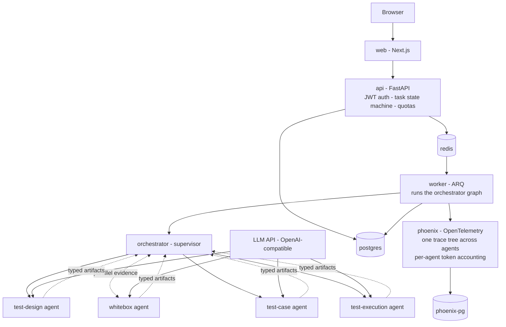

# mini-ai-test-agent-platform

A self-hostable, fully dockerized **multi-agent collaboration platform** —
domain agents (test design, whitebox analysis, test cases, execution) working
under a supervisor orchestrator, with the production elements that separate a
demo from a system people rely on: async task queues, multi-tenant isolation,
auth, cost quotas, retries, and centralized observability.

**Why this exists:** the problem comes from a real AI testing platform I own —
an internal system whose agent acts as a Project Test Manager, in daily use by
80+ engineers across 8 business lines. Running it taught me where local
tooling stops and production begins. Industry practice (at every major tech
company) is the same shape: **not one clever agent, but several narrow agents
collaborating over structured artifacts, with humans at the gates.** This repo
is my independent, from-scratch implementation of that pattern.

## What it does (v0 scope)

One flow, four domain agents, two human gates:

```
PRD -> [test-design agent] <-- parallel evidence -- [whitebox agent]
          |                                             (interfaces, edges)
          v
      HUMAN GATE (is the strategy right?)
          v
      [test-case agent]  -> draft cases (steps, data, assertions)
          v
      HUMAN GATE (can these run?)
          v
      [test-execution agent] -> run, collect -> execution report
```

Every agent is itself a small LangGraph; a supervisor orchestrator routes
tasks across agents, and agents exchange **typed artifacts** (pydantic), never
free-form chat.

## Architecture



Seven containers, one `docker compose up`.

## Production elements -> how you can see them

| # | Production element | Implementation | How you experience it |
|---|---|---|---|
| 1 | Async long tasks | Submit job -> ARQ queue -> poll/SSE | Submit and close the tab; the run survives |
| 2 | Cooperative cancel | Cancel flag checked between agent handoffs | Cancel mid-run; the orchestrator stops at the next gate, not mid-token |
| 3 | Multi-tenant isolation | thread_id = user:task namespacing; row-level ownership | Two users never see each other's runs |
| 4 | Auth | JWT login; every route scoped | Anonymous requests get 401 before touching the queue |
| 5 | Cost quotas | Per-user token budget; middleware check | Overage returns 429 with a quota header |
| 6 | Failure retry + idempotency | ARQ retry; idempotency keys on artifacts | kill worker mid-run -> restart -> task resumes, no dupes |
| 7 | Rate limiting | Semaphore around LLM calls | Concurrency spike degrades gracefully |
| 8 | Cross-agent observability | One Phoenix trace tree: orchestrator root span -> child spans per agent | Follow one task across all agents; token cost aggregated per agent |
| 9 | Artifact contracts | pydantic schemas with version field; agents reject unknown versions | A schema change shows up as a failing test, not a silent hallucination |
| 10 | Health checks and graceful shutdown | compose healthchecks; SIGTERM drains in-flight agents | docker compose stop never orphans a task |
| 11 | CI/CD | GitHub Actions: lint + pytest on every push | Red CI blocks merge |

Design decisions live in [docs/adr/](docs/adr/); the full multi-agent design in
[docs/DESIGN.md](docs/DESIGN.md).

## Stack

FastAPI · ARQ (redis) · LangGraph (supervisor + per-agent graphs) · Pydantic artifacts · PostgreSQL · Next.js · Phoenix (OpenTelemetry) · Docker Compose · pytest

## Scope and attribution

- This is a **personal, independent project**. It contains no employer code,
  no internal terminology, and no company data; all API keys are personal.
- The multi-agent workflow is inspired by problems observed while operating an
  internal AI testing platform; every line here is written from scratch for
  learning in the open.

## License

MIT
