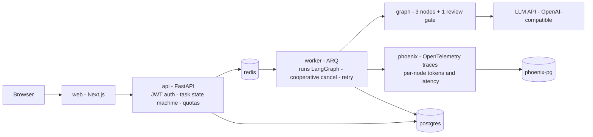

# mini-agent-platform

A self-hostable, fully dockerized **production-grade LLM agent platform** — a
reference implementation of the engineering elements that separate a demo from
a system people rely on every day: async task queues, multi-tenant isolation,
auth, cost quotas, retries, and centralized observability.

**Why this exists:** the problem comes from a real AI testing platform I own —
an internal agent system (the agent acts as a Project Test Manager) in daily
use by 80+ engineers across 8 business lines. Running it taught me exactly
where local tooling stops and production begins. This repo is my independent,
from-scratch implementation of those missing production elements.

## What it does (v0 scope)

One workflow: **PRD -> draft test cases -> human review gate -> refined output.**

A 3-node LangGraph pipeline with a single human-in-the-loop checkpoint, run as
an async background job (ARQ) behind a FastAPI service — not a notebook, not a
script: a small system with queues, identities, budgets, and failure drills.

## Architecture

Seven containers, one `docker compose up`.

## Production elements -> how you can see them

| # | Production element | Implementation | How you experience it |
|---|---|---|---|
| 1 | Async long tasks | Submit job -> ARQ queue -> poll/SSE | Submit and close the tab; the run survives |
| 2 | Cooperative cancel | Cancel flag checked between graph nodes | Cancel mid-run; nodes stop at the next gate, not mid-token |
| 3 | Multi-tenant isolation | thread_id = user:task namespacing; row-level ownership | Two users never see each other's runs |
| 4 | Auth | JWT login; every route scoped | Anonymous requests get 401 before touching the queue |
| 5 | Cost quotas | Per-user token budget in postgres; middleware check | Overage returns 429 with a quota header |
| 6 | Failure retry + idempotency | ARQ retry with idempotency keys | kill worker mid-run -> restart -> task resumes, no dupes |
| 7 | Rate limiting | Semaphore around LLM calls | Concurrency spike degrades gracefully, not catastrophically |
| 8 | Centralized observability | Phoenix with openinference auto-instrumentation | Every node's input/output/tokens/latency in one UI |
| 9 | Health checks and graceful shutdown | compose healthchecks; SIGTERM drains in-flight nodes | docker compose stop never orphans a task |
| 10 | CI/CD | GitHub Actions: lint + pytest on every push | Red CI blocks merge; green means the graph still passes its tests |

## Roadmap (5 weeks, evenings)

- [ ] **W1** Scaffold: compose up all containers; 3-node graph runs sync end-to-end
- [ ] **W2** JWT auth + postgres wiring + tenant isolation on thread_id
- [ ] **W3** Async: ARQ queue, task state machine, SSE progress, cooperative cancel (the hard week)
- [ ] **W4** Quotas, rate limiting, health checks, centralized Phoenix, GitHub Actions
- [ ] **W5** Failure drills: kill worker mid-run, cut LLM network, exhaust quota, locust load test — then write the ADRs

Design decisions are recorded as ADRs in [docs/adr/](docs/adr/).

## Stack

FastAPI · ARQ (redis) · LangGraph · PostgreSQL · Next.js · Phoenix (OpenTelemetry) · Docker Compose · pytest

## Scope and attribution

- This is a **personal, independent project**. It contains no employer code,
  no internal terminology, and no company data; all API keys are personal.
- The workflow pattern (generate -> review gate -> refine) is inspired by
  problems observed while operating an internal AI testing platform; every
  line here is written from scratch for learning in the open.

## License

MIT
