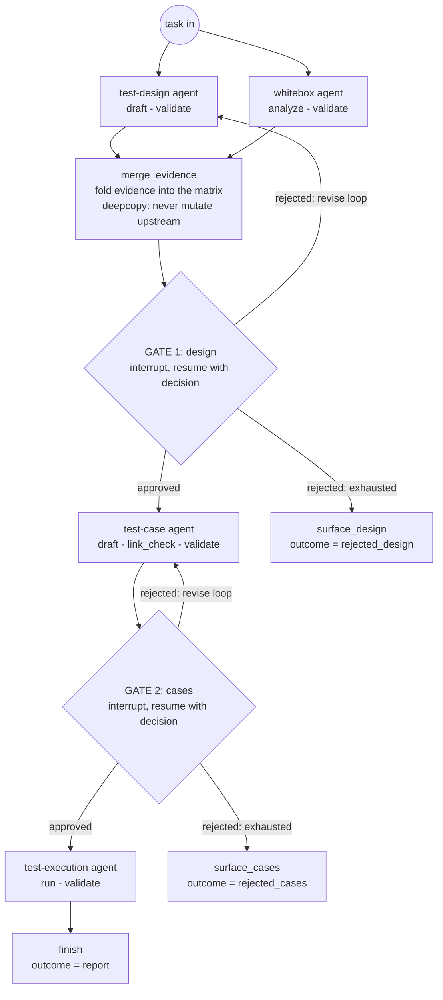
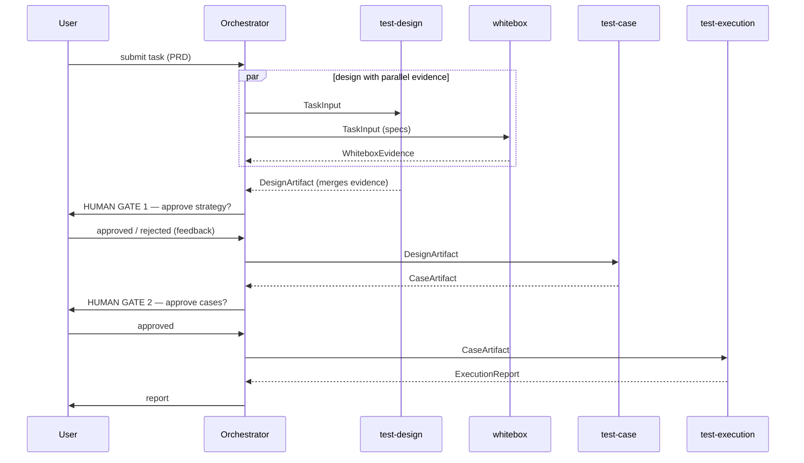
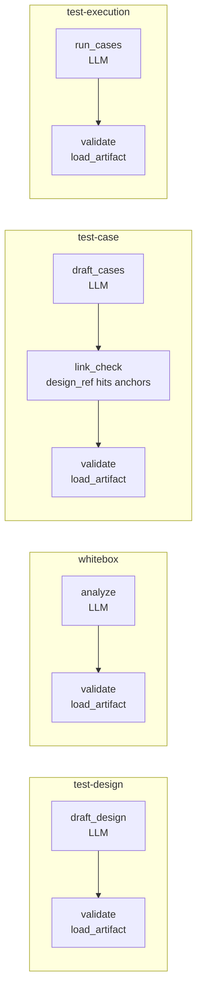

# Multi-agent design

Detailed design for agent collaboration in mini-ai-test-agent-platform. Decision
rationale lives in [ADR 0002](adr/0002-multi-agent-collaboration.md); this
document is the how.

## 1. Principles

1. **Protocol before topology.** First make the collaboration correct
   (artifact schemas, gate semantics), then make it distributed (independent
   containers, queues). Never introduce both complexities at once.
2. **Agents exchange artifacts, never prose.** Every handoff is a versioned,
   pydantic-validated payload. If an agent needs to "just explain", that
   explanation belongs in a schema field.
3. **Human gates are first-class citizens.** A gate is a graph node with its
   own state, not an afterthought bolted onto a chat loop.
4. **Every token is attributable.** Cost is aggregated per agent per task; the
   first question an operator asks is "which agent burns money", so the trace
   tree must answer it by construction.

## 2. Agents and responsibilities

| Agent | Input | Output artifact | Responsibility | Failure semantics |
|---|---|---|---|---|
| **orchestrator** (supervisor) | user task | `ExecutionReport` (final) | Route task -> agents; insert human gates; aggregate report | Retries handoffs; never edits artifacts |
| **test-design** | `TaskInput` (PRD text) | `DesignArtifact` | What to test: strategy, risks, coverage matrix | Bounded revise loop on gate rejection |
| **whitebox** | PRD + interface specs | `WhiteboxEvidence` | Static view: interface contracts, boundary values, branch points; runs in parallel with design and merges as evidence | Optional stage; missing evidence degrades design, never blocks |
| **test-case** | `DesignArtifact` (+ evidence) | `CaseArtifact` | Concrete cases: steps, data, assertions, priority | Bounded revise loop; cases must link to design items |
| **test-execution** | approved `CaseArtifact` | `ExecutionReport` | Orchestrate runs, collect results per case | Per-case retry; report marks failed cases explicitly |

## 3. Artifact contract (v1)

```python
class BaseArtifact(BaseModel):
    version: Literal["v1"]
    task_id: str
    idempotency_key: str          # uuid5(task_id, agent, stage)
    produced_by: AgentName

class DesignArtifact(BaseArtifact):
    kind: Literal["design"]
    scope: list[str]              # what to test
    risks: list[str]
    coverage_matrix: list[CoverageItem]

class WhiteboxEvidence(BaseArtifact):
    kind: Literal["evidence"]
    items: list[EvidenceItem]     # source / finding / risk_hint

class CaseArtifact(BaseArtifact):
    kind: "cases"
    items: list[TestCase]         # steps / data / assertion / priority / design_ref
```

- **Versioning:** agents validate `version` and reject unknown values with a
  typed error — a schema change is a failing test, not silent drift.
- **Idempotency key:** worker restarts re-emit the same artifact id, so retry
  after a crash cannot duplicate downstream effects.

## 4. Collaboration sequence

### Topology — the orchestrator graph



Revise rounds re-run **only the design branch** (whitebox evidence is static
fact and survives; the merged matrix is rebuilt from the fresh design on
every pass — the deepcopy rule keeps this idempotent).

### Message sequence



## 5. Collaboration mode: two phases

**Phase 1 (W1.5-W3): supervisor in one process.** The orchestrator is a
LangGraph; each agent is a subgraph invoked by handoff. All agents live in one
worker container. This validates the protocol — schemas, gates, revise loops —
with zero distributed-systems overhead.

**Phase 2 (W4+): agents as independent containers.** Each agent gets its own
worker + queue; the orchestrator publishes handoff messages on redis streams.
Adds: dead-letter queues, per-agent autoscaling, cross-container trace
continuity. Only the topology changes — the artifact contract is untouched,
which is exactly why it was designed first.

Rejected for v0: free-form multi-agent chat (no testable contract), and a
hard-coded pipeline (no collaboration semantics, just a pipe).

## 6. Observability and cost

- The orchestrator opens the root span (`task_id`); every agent handoff opens
  a child span named by agent — one trace tree per task across all agents.
- Token usage is recorded per agent per node; Phoenix attributes roll up to
  per-agent cost. Dashboards answer "which agent burns money" without log
  archaeology.
- Human gates are spans too: gate wait time is a first-class metric (it is
  usually the largest latency component, and hiding it hides the truth).

## 7. Failure semantics

| Failure | Behavior |
|---|---|
| Agent LLM call fails | Node-level retry (bounded); artifact idempotency key prevents duplicates |
| Worker crash mid-graph | ARQ redelivers; graph resumes from last checkpointed state |
| Gate rejected | Normal path, not an error: bounded revise loop (max N), then surface to human |
| Schema mismatch at handoff | Typed rejection, task marked failed — never forwarded silently |
| Cancel requested | Cooperative flag checked at every handoff boundary; current node finishes, next never starts |

## 8. Evaluation

- **Per-agent unit tests:** fixture input -> artifact assertions (schema +
  semantic invariants, e.g. every case links to a design item).
- **Orchestrator tests:** gate semantics (rejection terminates, approval
  proceeds), artifact version rejection.
- **Golden-set end-to-end (W4):** a small frozen PRD set with expected
  artifact shapes; runs in CI as the collaboration regression suite.

## 9. Agent internals

Each domain agent is a small graph of typed nodes. No agent contains a human
gate — gates belong to the orchestrator (section 2), which keeps agents pure
business logic and makes collaboration semantics testable in one place.

| Agent | Nodes | LLM calls | Contract enforcement |
|---|---|---|---|
| test-design | `draft_design → validate` | 1 (PRD + revise feedback) | `load_artifact` after draft |
| whitebox | `analyze → validate` | 1 (PRD/specs) | `load_artifact` after analyze |
| test-case | `draft_cases → link_check → validate` | 1 (design summary) | every `design_ref` must hit an anchor (scope ∪ matrix areas) |
| test-execution | `run_cases → validate` | 1 (cases) | `load_artifact` after run |

Evidence merge lives in the **orchestrator** (`merge_evidence` node), not in
the design agent: the two agents run in parallel, so the design agent cannot
see whitebox output. Two invariants make the merge safe:

- **Deep-copy on join.** The orchestrator never mutates an upstream artifact.
  A shallow copy shares the nested `coverage_matrix` list, and a revise round
  would fold the same evidence twice — silently breaking handoff idempotency.
- **Degrade, never block.** Whitebox failure marks evidence empty and logs a
  warning; the design proceeds on its own matrix (section 2 semantics).

LLM access is a single injectable seam (`agents/llm.py`): production uses an
OpenAI-compatible endpoint from env config; tests inject `FakeLLM`, whose
responses are routed by system-prompt substring (parallel branches consume
independent queues, so fan-out order never matters) and deep-copied on
consume.

### Inside the agents



## 10. Revise loop

Human gates are implemented with `langgraph.types.interrupt` + a checkpointer:
the gate node suspends the graph, the API resumes it with
`{"approved": bool, "feedback": str}`.

- **approved** → next stage.
- **rejected, attempts < MAX_REVISE (=2)** → back to the stage's handoff; the
  agent re-runs with the feedback injected into its prompt.
- **rejected, attempts exhausted** → `surface_<stage>` node records
  `outcome="rejected_<stage>"` and ends the run — a human decides what is
  next; the loop never spins silently.

Whitebox evidence survives revise rounds: a rejected design re-runs only the
design branch, and static facts are reused. The fan-in node clears consumed
feedback, which also keeps parallel branches free of shared state writes.

## 11. Token & cost model

**Call-count bound (structural).** The happy path makes exactly **4 LLM calls
per task** — one per agent; each revise round adds exactly 1. With
MAX_REVISE=2 the per-task upper bound is **6 calls**. The bound is a property
of the graph topology, not an aspiration — it is pinned by a regression test
(`test_llm_call_count_is_bounded`).

**Context shape.** design and whitebox each consume the full PRD (parallel
branches: unavoidable 2×PRD); cases consumes the design artifact; execution
consumes the cases artifact — context grows linearly downstream. If real
artifacts grow large, the lever is summary-forwarding (pass digests between
agents, fetch full artifacts by id); not needed at v0 sizes.

**Model routing.** Each agent resolves its model through env: a
per-agent override (`MINI_AGENT_LLM_MODEL_<AGENT>`) falls back to the shared
`MINI_AGENT_LLM_MODEL`. Typical split: strong model for design/case
generation, cheaper model for execution verdicts. Per-agent token attribution
(section 6) shows where the money goes; routing is how you act on it.

**Not in the graph.** Per-task/per-tenant budget enforcement and kill
switches belong to the API/worker quota layer (README element "cost
quotas") — the graph stays a pure workflow and does not duplicate platform
concerns. Provider-side prompt caching is a W2+ optimization once real
traffic shows repeat prefixes.

## 12. Disagreement resolution

Design and whitebox **cannot disagree destructively**, by construction: the
roles are asymmetric. Whitebox emits factual evidence (`source / finding /
risk_hint`) and has no write access to the design; design emits decisions and
has no write access to evidence. Merge folds each evidence item into its own
coverage-matrix row next to the design's own judgement — disagreement shows
up as two rows over the same area, never as one overwriting the other.

The arbitration owner is the **human gate**, with two mechanisms:

- **Veto (implemented).** A gate decision may carry `drop_areas: [...]`.
  The veto is durable task state: every later merge pass skips vetoed
  areas, including after revise rounds — the orchestrator never silently
  re-proposes evidence a human has declined (regression-tested).
- **Disposition (W2).** The design agent will be required to answer every
  evidence item with `integrate` or `rebut` (+ reason). Rebutted items are
  flagged as agent disagreement at the gate, so the human arbitrates only
  the contested rows instead of scanning the full matrix.

Failure of whitebox is a degenerate case of the same rule: absent evidence
cannot conflict with anything (section 9, degrade never blocks).
